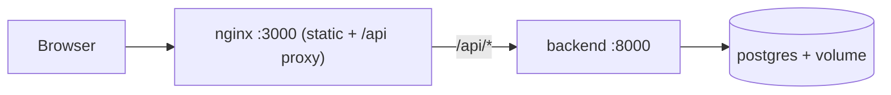
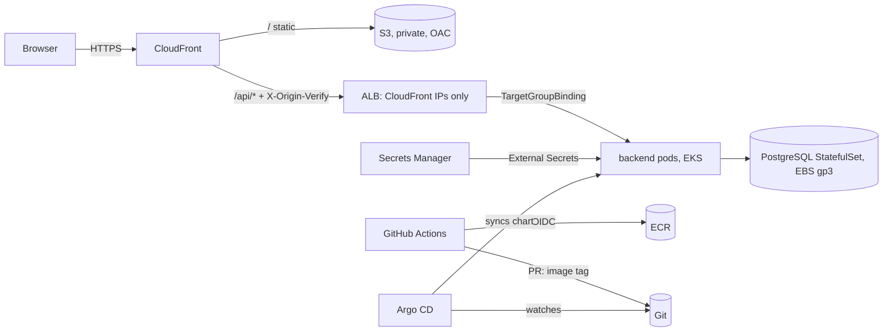

# TaskBoard: from laptop to production on AWS EKS

Next.js frontend + FastAPI backend + PostgreSQL, containerised, scanned, packaged with Helm,
run locally on minikube and deployed to AWS EKS with Terraform, GitHub Actions (OIDC) and Argo CD.

## Architecture

### Local

### AWS


## Run locally
```bash
cd local-setup && docker compose up --build        # http://localhost:3000
./scan-local.sh                                    # all scanners (Phase A3)
cd minikube && ./up.sh                             # helm install + helm test
./up.sh argocd                                     # GitOps mode (push repo to GitHub first)
./down.sh
```
## Deploy to AWS
1. `cd infra/bootstrap && cp terraform.tfvars.example terraform.tfvars && terraform init && terraform apply`
2. Set GitHub Variables (see table in the assignment) from the outputs; create environments `infrastructure` and `production`.
3. Merge Terraform to `main`, approve the apply (~20 min).
4. Fill `CHANGE_ME` in `deploy/helm/taskboard/values-prod.yaml` and the repo URL in `gitops/applications/*.yaml`.
5. `aws eks update-kubeconfig --region eu-west-1 --name taskboard-prod && ./gitops/install-argocd.sh gitops/applications/taskboard-prod.yaml`
## Release
Publish a GitHub Release `vX.Y.Z` on a commit of `main` whose image was built: the workflow retags
`sha-<commit>` as `vX.Y.Z`, opens a PR bumping `backend.image.tag`, and deploys the frontend (approval on `production`).
Rollback = `git revert` of the deployment commit.
## Clean up
`kubectl -n argocd delete application taskboard` -> wait for PVC/pods to go -> `terraform destroy` in `infra/environments/prod` -> check EC2 for leftover EBS/ALB.

## Decisions & trade-offs
- **Public ALB restricted to CloudFront** (prefix-list SG + secret header): cheap, no VPN. Real company: CloudFront VPC origins (internal ALB), WAF, custom domain + ACM end to end.
- **PostgreSQL in the cluster** (StatefulSet+EBS): cheap and teaches StatefulSets. Real company: RDS/Aurora (backups, PITR, Multi-AZ, patching).
- **Infra role = AdministratorAccess**: Terraform creates VPC/EKS/IAM. Real company: split plan (read-only) and apply roles, permission boundaries.
- **Single NAT gateway / public EKS endpoint**: cost. Real company: NAT per AZ, private endpoint + VPN/SSM.
- **GitOps PR as deployment approval**: auditable, rollback by revert, CI never holds cluster credentials.
- **Accepted scanner findings** are listed with reasons in `.trivyignore`.

## Decisions & Trade-offs

### Public ALB (Intentional Design Decision)

The Application Load Balancer is intentionally configured with `internal = false` to support the project's CloudFront-based architecture.

To restrict access to the origin:
- Allow inbound HTTP traffic only from the CloudFront origin-facing managed prefix list.
- Use the `X-Origin-Verify` header to verify requests before forwarding them to the backend.
- Return HTTP 403 Forbidden for requests that do not match the origin verification rule.

**Trade-off:** The ALB remains internet-facing, but access is restricted through network rules and origin verification.

**Stretch Goal:** Evaluate CloudFront VPC origins to use an internal ALB in a future iteration.